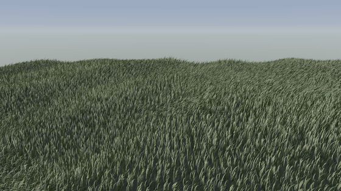

# RealityGrass

GPU-generated, wind-animated grass for RealityKit on visionOS, iOS and macOS.



*300,000 blades with gusts moving through in clumps, using the `.muted` palette and rendered offscreen with RealityKit on macOS. For grass around water, see the wetland gallery in [ImmersiveWeather](https://github.com/Cleozhang999/ImmersiveWeather).*

- Blades are generated by a Metal compute shader and written into a `LowLevelMesh`, with no per-vertex CPU work.
- Blades taper to a point and curl, with random lean, height and curl, plus height that varies in patches.
- Wind arrives in gusts: a drifting noise field presses down one clump of grass at a time, the clumps travel downwind and change shape as they go, and each blade flutters a little on its own.
- A procedural default material gives each blade its own shade of green, a dark root and a bright tip. Some blades are dry, and no texture files are needed.
- All fields in a scene are animated in one command buffer per frame.
- Distance-based LOD animates far-away fields less often.
- Placement is seeded and reproducible, and can filter by slope and minimum height (to keep grass out of water, for example).

## Requirements

- visionOS 2 / iOS 18 / macOS 15 or later (`LowLevelMesh`)
- Xcode 16 or later, with the Metal toolchain installed

## Installation

```swift
.package(url: "https://github.com/Cleozhang999/RealityGrass.git", from: "0.3.0")
```

## Usage

```swift
import RealityGrass
import RealityKit

RealityView { content in
    // 1. Describe the ground. Y is up.
    let ground = GroundSample.grid(size: [4, 4], resolution: [64, 64]) { x, z in
        0.15 * sin(x * 1.3) * cos(z * 0.9)
    }

    // 2. Decide where blades grow.
    let roots = GrassScatter(density: 600, maxSlope: .pi / 5, minHeight: -0.05).roots(on: ground)

    // 3. Build the field.
    let grass = try await GrassFieldEntity(
        roots: roots,
        shape: GrassBladeShape(height: 0.3, width: 0.02),
        wind: .breeze
    )
    content.add(grass)
}
```

Change the wind at any time:

```swift
grass.wind = .gusty
// gustLength: the size of a gust clump in meters. frequency: how fast clumps travel (about frequency × gustLength / 2 m/s).
grass.wind = GrassWind(strength: 0.4, frequency: 2, direction: [0, 0, 1], gustLength: 6)
```

### Ground from your own mesh

`GroundSample` is just a position and a normal, so you can feed in vertices from any terrain, such as a height-map mesh or a scanned room:

```swift
let samples = terrainVertices.map { GroundSample(position: $0.position, normal: $0.normal) }
```

### Level of detail

LOD needs to know where the viewer is. Update `viewerPosition` from your head-tracking code:

```swift
let head = deviceAnchor.originFromAnchorTransform.columns.3
grass.viewerPosition = [head.x, head.y, head.z]
```

LOD applies to a whole field at once, so to get finer control over large areas, build several smaller fields (tiles). Customize the levels with `GrassLOD(levels:)` or turn LOD off with `.disabled`.

### Materials

By default each field uses `GrassMaterial.make()`, which uses the `.meadow` palette. To change the colors, pick another palette (`.meadow`, `.muted` for soft sage tones, or `.lateSummer`) or define your own:

```swift
let material = try await GrassMaterial.make(palette: .muted)
let grass = try await GrassFieldEntity(roots: roots, material: material)
```

You can also pass any RealityKit material. UV `v` runs from 0 at the root to 1 at the tip, and UV `u` is a random value per blade, constant along the blade. A texture with color variations across and a gradient from bottom to top therefore works well. Use `faceCulling = .none`, because blades are single quads.

## How it works

| Stage | Where | What |
|---|---|---|
| Scatter | CPU, once | Filter ground samples by slope and height, then randomly pick root positions with jitter |
| Generate | GPU, once | `generateGrassBlades`: 8 vertices per blade (three tapering quads), random yaw, lean, curl and height, height noise in patches, normals tilted skywards for soft lawn shading |
| Animate | GPU, every N frames | `updateGrassVertices`: sample a two-octave noise field that drifts downwind, turn it into gust strength and a slight change in direction, then rotate each vertex around the blade root, scaled by height² |

## Testing

```bash
swift test
```

## License

MIT. See [LICENSE](LICENSE).
